# PRS1 · Arquitectura



## Estructura MVC mejorada — principal

Raíz canónica: `pe.edu.vallegrande.caneteseguro.<contexto>`.

```text
<microservice>/
├── pom.xml
├── Dockerfile
├── README.md
├── .env.example
└── src/
    ├── main/
    │   ├── java/pe/edu/vallegrande/caneteseguro/<contexto>/
    │   │   ├── <Contexto>Application.java [class]
    │   │   ├── controller/                 [class]
    │   │   ├── service/
    │   │   │   ├── <Aggregate>Service.java [interface]
    │   │   │   └── impl/                   [class]
    │   │   ├── repository/
    │   │   │   ├── <Aggregate>Repository.java [interface]
    │   │   │   └── impl/                   [class]
    │   │   ├── model/
    │   │   │   ├── <Aggregate>.java        [class]
    │   │   │   └── <Status>.java           [enum]
    │   │   ├── dto/
    │   │   │   ├── request/                [record]
    │   │   │   └── response/               [record]
    │   │   ├── mapper/                     [interface]
    │   │   ├── client/                     [interface y class]
    │   │   ├── config/                     [configuration class]
    │   │   ├── security/                   [configuration y class]
    │   │   └── exception/                  [exception y handler]
    │   └── resources/
    │       ├── application.yml
    │       ├── application-dev.yml
    │       └── application-prod.yml
    └── test/
        └── java/
            └── pe/edu/vallegrande/caneteseguro/<contexto>/ [test class]
```

## Estructura hexagonal — opcional

## Árbol completo de carpetas y paquetes

Raíz canónica: `pe.edu.vallegrande.caneteseguro.<contexto>`.

```text
<microservice>/
├── pom.xml
├── Dockerfile
├── README.md
├── .env.example
├── src/main/java/pe/edu/vallegrande/caneteseguro/<contexto>/
│   ├── <Contexto>Application.java [class]
│   ├── domain/                    [package: clases puras]
│   │   ├── model/                 [class y enum]
│   │   │   ├── <Aggregate>.java   [class]
│   │   │   └── <Status>.java      [enum]
│   │   ├── valueobject/           [record]
│   │   │   ├── <Aggregate>Id.java [record]
│   │   │   └── TenantId.java      [record]
│   │   └── exception/             [exception]
│   │       └── <BusinessRule>Exception.java [exception]
│   ├── application/               [casos de uso y puertos]
│   │   ├── port/
│   │   │   ├── in/                [interface]
│   │   │   │   └── <Verb><Aggregate>UseCase.java [interface]
│   │   │   └── out/               [interface]
│   │   │       ├── <Aggregate>RepositoryPort.java [interface]
│   │   │       └── <Remote>ClientPort.java [interface]
│   │   ├── usecase/               [class]
│   │   │   └── <Verb><Aggregate>UseCaseImpl.java [class]
│   │   ├── dto/
│   │   │   ├── input/             [record]
│   │   │   └── output/            [record]
│   │   ├── context/               [record]
│   │   │   └── TenantContext.java [record]
│   │   └── exception/             [exception]
│   │       └── ApplicationException.java [exception]
│   └── infrastructure/            [adaptadores Spring]
│       ├── adapter/
│       │   ├── in/
│       │   │   └── rest/
│       │   │       ├── <Aggregate>Controller.java [class]
│       │   │       ├── dto/
│       │   │       │   ├── request/  [record]
│       │   │       │   └── response/ [record]
│       │   │       └── mapper/       [interface]
│       │   └── out/
│       │       ├── persistence/
│       │       │   └── mongo/
│       │       │       ├── document/     [class]
│       │       │       ├── repository/ [interface]
│       │       │       └── mapper/     [interface]
│       │       └── http/
│       │           └── <remote>/
│       │               ├── dto/
│       │               │   ├── request/  [record]
│       │               │   └── response/ [record]
│       │               ├── mapper/       [interface]
│       │               └── <Remote>WebClientAdapter.java [class]
│       ├── config/        [configuration class]
│       ├── security/      [configuration y class]
│       └── exception/     [exception handler y enum]
├── src/main/resources/
│   ├── application.yml
│   ├── application-dev.yml
│   └── application-prod.yml
├── src/test/
│       └── java/
│           └── pe/edu/vallegrande/caneteseguro/<contexto>/
│               ├── domain/               [test class]
│               ├── application/          [test class]
│               └── infrastructure/       [test class]
```

## Capa de aplicación e integraciones HTTP

```text
application/
├── port/in/                                  [interfaces de casos de uso]
├── port/out/                                 [interfaces repository/client]
├── usecase/                                  [classes de implementación]
├── dto/input/                                [records]
├── dto/output/                               [records]
└── exception/                                [excepciones de aplicación]

infrastructure/adapter/out/http/<remote>/
├── config/
│   ├── <Remote>ClientProperties.java         [configuration properties]
│   └── <Remote>WebClientConfig.java          [configuration class]
├── dto/request/                              [records enviados]
├── dto/response/                             [records recibidos]
├── mapper/                                   [interfaces]
├── exception/                                [traductores de error]
└── <Remote>WebClientAdapter.java             [class]
```

## Tenant, comunicación y datos

### Tree de multitenancy

```text
<contexto>/
├── domain/valueobject/TenantId.java           [record]
├── application/context/TenantContext.java     [record]
└── infrastructure/
    ├── security/JwtTenantClaimResolver.java   [class]
    ├── security/TenantAccessValidator.java    [class]
    ├── web/TenantContextWebFilter.java        [class]
    └── persistence/TenantCriteria.java        [class]
```

## Árbol especial del gateway

```text
pe/edu/vallegrande/caneteseguro/gateway/
├── GatewayApplication.java
└── infrastructure/
    ├── config/
    ├── filter/
    ├── security/
    └── exception/
```
