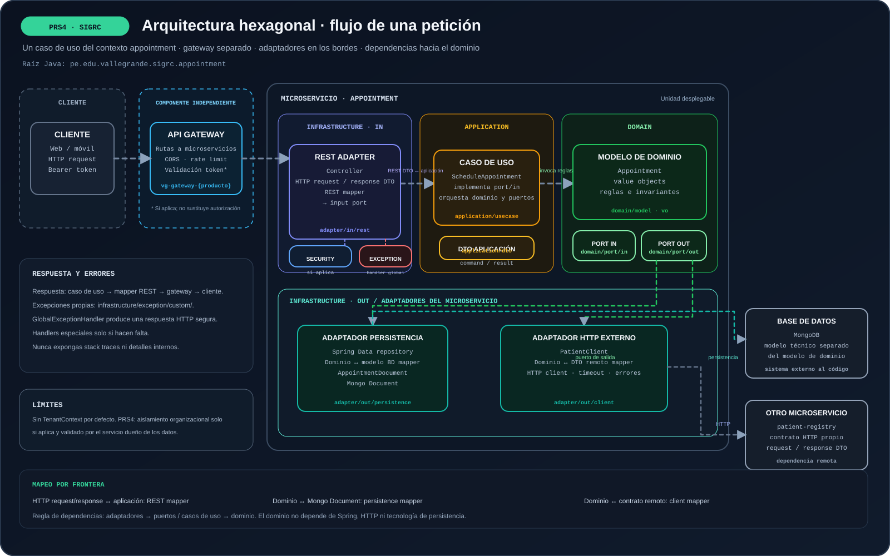

# PRS4 · Arquitectura



## Propósito

Estándar hexagonal para los microservicios de SIGRC. El dominio y los casos de uso forman el núcleo; REST, persistencia, clientes HTTP y almacenamiento son adaptadores. Usa la raíz `pe.edu.vallegrande.sigrc.{contexto}` y agrega solo componentes usados por el servicio.

## Árbol estándar

```text
vg-ms-{servicio}/
├── pom.xml
├── Dockerfile
├── README.md
├── .env.example                 # Variables de ejemplo; sin secretos reales
├── .dockerignore
├── .gitignore
└── src/
    ├── main/
    │   ├── java/pe/edu/vallegrande/sigrc/{contexto}/
    │   │   ├── {Servicio}Application.java
    │   │   ├── domain/
    │   │   │   ├── model/                    # Entidades y agregados del dominio
    │   │   │   ├── vo/                       # Value objects y enums del dominio
    │   │   │   └── port/
    │   │   │       ├── in/                   # Contratos de casos de uso
    │   │   │       └── out/                  # Contratos de repositorio/client/storage
    │   │   ├── application/
    │   │   │   ├── usecase/                  # Una clase por acción de negocio
    │   │   │   ├── dto/
    │   │   │   │   ├── request/
    │   │   │   │   └── response/
    │   │   │   └── mapper/                   # Solo mapeos propios de aplicación
    │   │   ├── infrastructure/
    │   │   │   ├── adapter/
    │   │   │   │   ├── in/
    │   │   │   │   │   └── rest/
    │   │   │   │   │       ├── controller/
    │   │   │   │   │       ├── dto/
    │   │   │   │   │       │   ├── request/
    │   │   │   │   │       │   └── response/
    │   │   │   │   │       └── mapper/       # REST request/response <-> aplicación
    │   │   │   │   └── out/
    │   │   │   │       ├── persistence/
    │   │   │   │       │   └── {tecnologia}/
    │   │   │   │       │       ├── entity/       # Modelo JPA/SQL; no es el modelo de dominio
    │   │   │   │       │       ├── document/     # Documento MongoDB; no es el modelo de dominio
    │   │   │   │       │       ├── repository/   # Spring Data
    │   │   │   │       │       ├── mapper/       # Dominio <-> entity/document
    │   │   │   │       │       └── {Repository}Adapter.java
    │   │   │   │       ├── client/
    │   │   │   │       │   └── {cliente}/
    │   │   │   │       │       ├── dto/          # Contratos HTTP externos
    │   │   │   │       │       ├── mapper/       # Dominio <-> DTO externo
    │   │   │   │       │       └── {Cliente}ClientAdapter.java
    │   │   │   │       └── storage/              # Solo si usa archivos
    │   │   │   ├── security/                          # Spring Security/JWT/JWE/filtros
    │   │   │   ├── exception/
    │   │   │   │   ├── custom/                        # Excepciones propias necesarias
    │   │   │   │   ├── GlobalExceptionHandler.java
    │   │   │   │   ├── RestExceptionHandler.java      # Solo si hace falta
    │   │   │   │   └── ValidationExceptionHandler.java # Solo si hace falta
    │   │   │   └── config/                            # Configuración concreta de Spring
    │   └── resources/
    │       ├── application.yml
    │       └── db/migration/                 # Solo SQL con Flyway/Liquibase
    └── test/java/pe/edu/vallegrande/sigrc/{contexto}/
        ├── domain/
        ├── application/
        └── infrastructure/
```

## Responsabilidades y dependencias

- `domain/model` y `domain/vo` contienen comportamiento y conceptos del negocio; no dependen de Spring, HTTP ni bases de datos.
- `domain/port/in` declara las acciones ofrecidas por el servicio. `domain/port/out` declara lo que el núcleo necesita de persistencia, clientes o storage.
- `application/usecase` implementa cada acción y coordina dominio y puertos. No conoce implementaciones concretas.
- `infrastructure/adapter/in/rest` recibe HTTP, valida formato, mapea la solicitud y llama al caso de uso. No contiene reglas de negocio ni consulta Spring Data.
- `infrastructure/adapter/out` implementa puertos de salida. El repositorio Spring Data es detalle interno del adaptador de persistencia.
- Las dependencias apuntan hacia el núcleo: los adaptadores dependen de los puertos; el dominio no depende de infraestructura.

## Mappers y modelos por frontera

| Frontera | Ubicación | Conversión |
|---|---|---|
| REST | `infrastructure/adapter/in/rest/mapper/` | Request/response HTTP ↔ modelo de aplicación o dominio |
| Persistencia | `infrastructure/adapter/out/persistence/{tecnologia}/mapper/` | Dominio ↔ `Entity` SQL o `Document` MongoDB |
| Cliente externo | `infrastructure/adapter/out/client/{cliente}/mapper/` | Dominio ↔ DTO propio del contrato externo |

El modelo de dominio, el modelo de base de datos, el DTO público y el DTO remoto representan fronteras distintas. No reutilices entidades de base de datos como respuesta REST ni DTOs externos dentro del dominio. Crea mappers cuando haya una transformación; si dos modelos son realmente iguales, no agregues un mapper vacío.

## Persistencia

Elige el motor que use el microservicio. Los modelos de dominio viven en `domain/model`; los modelos de base de datos y repositorios Spring Data quedan dentro del adaptador de persistencia. Usa sufijo `Entity` para el modelo SQL y `Document` para MongoDB. Para migraciones SQL, usa `resources/db/migration` solo si Flyway o Liquibase está configurado.

## Clientes HTTP externos

Cada cliente externo tiene su propio adaptador, DTOs request/response y mapper bajo `infrastructure/adapter/out/client/{cliente}/`. El adaptador traduce errores técnicos del protocolo a errores que la aplicación pueda manejar; no propaga tipos HTTP ni DTOs del proveedor al dominio.

## Excepciones y errores HTTP

- Excepciones personalizadas: `infrastructure/exception/custom/`, siguiendo la estructura del PRS; agrega solo las necesarias.
- Handlers en `infrastructure/exception/`: `GlobalExceptionHandler` centraliza errores; `RestExceptionHandler` y `ValidationExceptionHandler` se agregan solo si se requiere manejo diferenciado.
- No crees una jerarquía o un handler por capa ni un handler por cada excepción. Agrega un handler específico de validación solo si el contrato HTTP requiere una respuesta diferenciada.
- Registra causas técnicas en logs con el contexto necesario; no expongas stack traces, credenciales ni detalles internos al cliente.

## Seguridad

`infrastructure/security/` contiene configuración Spring Security, autenticación/autorización, filtros y validación JWT/JWE cuando el servicio los use. Mantén claves y credenciales fuera del repositorio; documenta nombres de variables en `.env.example` con valores ficticios.

## DTOs y Java records

Los DTOs request/response representan contratos HTTP o de aplicación, no entidades de persistencia. `record` es una opción para datos inmutables sencillos si la versión de Java lo permite; no es obligatorio ni un nombre de carpeta.

## Pruebas

Ubica pruebas de dominio, aplicación e infraestructura según las capas existentes. Prueba reglas y casos de uso sin levantar infraestructura cuando sea posible, y adaptadores mediante pruebas de integración cuando corresponda.

## Multitenancy

No agregues `TenantContext` por defecto. Incorpora aislamiento por organización solo si es un requisito del servicio; obtiene la organización de identidad autenticada y aplícala a autorización y consultas.

## Particularidad del producto

SIGRC puede requerir aislamiento por organización. Implementa esa política únicamente en los servicios que manejan datos de varias organizaciones; valida la organización desde la identidad autenticada y aplícala en todas las consultas.

## Gateway

El gateway es un componente desplegable independiente de los microservicios del producto. No se agrega dentro del árbol Java de cada microservicio ni reemplaza su arquitectura hexagonal. Su uso depende de que el producto necesite un punto de entrada común.

### Estructura de referencia

```text
vg-gateway-{producto}/
├── pom.xml
├── Dockerfile
├── README.md
├── .env.example
└── src/
    ├── main/
    │   ├── java/{base}/{gateway}/
    │   │   ├── GatewayApplication.java
    │   │   ├── config/             # Rutas definidas en código, solo si aplica
    │   │   ├── filter/             # Filtros globales o por ruta, solo si aplican
    │   │   ├── security/           # Validación de credenciales/tokens, si aplica
    │   │   └── exception/          # Errores propios y handler HTTP, si aplica
    │   └── resources/
    │       └── application.yml     # Rutas y configuración no secreta
    └── test/
        └── java/{base}/{gateway}/  # Pruebas de rutas y filtros
```

La estructura es una referencia: conserva solo los paquetes y archivos que el gateway necesite. Define las rutas en `application.yml` o mediante configuración Java; no mantengas ambas formas para la misma ruta. Usa variables de entorno para URLs y secretos, documentando solo nombres y valores ficticios en `.env.example`.

### Responsabilidades y límites

- Enruta solicitudes al microservicio propietario de cada recurso y conserva contratos HTTP claros.
- Aplica políticas transversales justificadas: validación de token, CORS, límites de tráfico, correlación y observabilidad. Configura resiliencia por ruta cuando el sistema lo requiera.
- Mantiene las reglas de negocio y la autorización sobre recursos en los microservicios. El gateway puede validar identidad y permisos generales, pero el servicio dueño vuelve a validar el acceso a sus datos.
- No contiene entidades de dominio, casos de uso, repositorios de negocio ni acceso directo a bases de datos. No transforma modelos de persistencia ni DTOs de los servicios.
- No propaga detalles internos ni stack traces en errores HTTP. Centraliza errores propios del gateway en `exception/` únicamente si necesita producir respuestas de error; los errores de negocio siguen siendo responsabilidad del servicio destino.
- Si se necesita composición de respuestas para una experiencia de cliente, trátala como un BFF/componente explícito, no como lógica de negocio escondida en filtros del gateway.

### Pruebas

Prueba resolución de rutas, filtros, políticas de seguridad y respuestas ante fallos de servicios destino. Mantén pruebas del gateway separadas de las pruebas de dominio y casos de uso de cada microservicio.